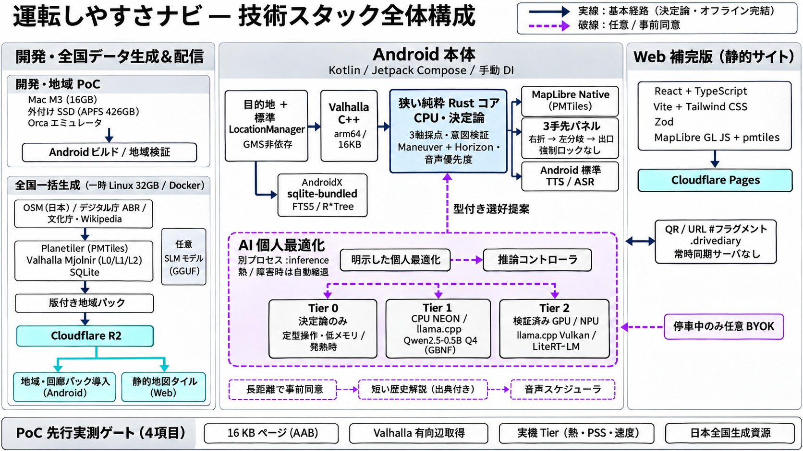

# 運転しやすさナビ — 設計仕様書一式

> **ステータス**: 設計合意完了（Round 1〜6：Codex `gpt-6.2-sol` Medium / Claude `claude-opus-5-5` / Gemini `gemini-4-hydrogen-medium` との協調設計）／**統合設計 v1.2 反映**
> **注意**: 本 `docs/` 配下に記載されたパフォーマンス目標・容量見積もり・しきい値の多くは、一次資料確認済み事項を除き **初期設計値（PoC Gate 0〜7 による実測・校正前提）** です。

---

## 1. プロジェクト概要

本プロジェクトは、**「日常の運転しやすさ」と「長距離ドライブの発見（歴史・地名解説）」を両立する、日本全国 47 都道府県対応・オンデバイス SLM 優先の Android 自前カーナビゲーションアプリ**（および Web 補完版）の設計・実装を目指すものです。

既存の大手ナビ（Google Maps 等）が最も得意とする「リアルタイム渋滞回避・最速到着」とは正面から競合せず、**「渋滞時は既存ナビへ受け渡して共存する」** ことを前提に、以下の独自価値に特化します。

1. **運転しやすさ最優先の経路選定（二層制御）**:
   - 左側通行の日本において負担の大きい **「対向車線を横切る無信号右折」「狭い生活道路（狭路）」「短い合流」「右折進入が必要な店舗・駐車場」** を避け、「+数分で信号なし右折を何回減らせるか」という 3 軸で経路を可視化・比較。
   - 基本の経路探索・採点・法規遵守は 100% **決定論的ロジック（L1/L2）** で完結させ、**LLM / SLM（L3）は個人最適化や曖昧な自然文要望を型付き制約へ変換する必要な場合のみ** 介入させます。
2. **マツダ風「3 つ先までの右左折先読み表示」（`ManeuverHorizon` 単一ソース）**:
   - 次だけでなく **3 つ先までの交差点・分岐・注意リスク** を一覧でき、画面表示と音声優先度スケジューラが単一の型モデルを参照します。
   - **強制的なマップ操作ロックは行わず**（Google Maps 同様）、走行時は操作を誘いにくい「ソフト適応 UI」へレイアウトを切り替えます。
3. **長距離・旅行時のみ提案する「出典付き歴史ラジオ」**:
   - 日常の通勤・買い物では一切邪魔をせず、長距離・旅行と判定された旅程の出発前に 1 回だけ事前同意を確認（既定 OFF）。安全窓に収まる場合のみ事前生成・出典付きの歴史解説を再生します。
4. **オンデバイス優先・GMS 非依存・基本無料公開**:
   - 端末内完結を基本とし、位置情報や走行履歴を外部サーバへ送りません。クラウド LLM は停車中の任意 **BYOK（ユーザー自身の API キー設定）** とし、運営サーバの維持費破綻を防ぎます。

---

## 2. 技術スタック全体構成図

*(図の注記: 画像中の `Maneuver + Horizon` は仕様書上の単一データモデル [`ManeuverHorizon`](specs/04-maneuver-horizon-and-hmi.md) を指します。)*

---

## 3. 確定した基本方針サマリー

| 項目 | 決定事項 | 詳細仕様 |
|---|---|---|
| **対象地域・車種** | **日本限定・最初から全国 47 都道府県対応**／**普通乗用車メイン**（大型車は対象外） | [01-product-and-ux.md](specs/01-product-and-ux.md) |
| **徒歩の扱い** | Phase 1〜2 は **駐車後のラストワンマイル徒歩**（車両入口・歩行者出口の分離管理）。Phase 3 で **散策モード** | [01-product-and-ux.md](specs/01-product-and-ux.md) |
| **プラットフォーム** | **Android ネイティブメイン**（Kotlin + Jetpack Compose）／**Web 補完版**（TypeScript + Vite + React + Zod） | [02-architecture-and-stack.md](specs/02-architecture-and-stack.md) |
| **コア・経路・DB** | **狭い純粋 Rust コア**（CPU 決定論、状態は持つが IO・スレッド・時計なし。**Rust C ABI v1**（12 関数）、イベント入口は **`dc_tick` に一本化**）＋ **Valhalla C++**（16 KB ページ対応、属性 sidecar を mmap）＋ **AndroidX `sqlite-bundled`**（`FTS5`/`R*Tree`） | [02-architecture-and-stack.md](specs/02-architecture-and-stack.md) |
| **二層制御 & AI** | L1 標準比較（決定論）／L2 個人設定（決定論）／L3 ローカル SLM（0.5B Q4, 別プロセス `:inference` 隔離＋Tier 0/1/2 GPU・NPU 動的切替）。走行中 L3 は **1 行命令コード**（GBNF 制約、解析は Rust）で、経路の確定入口は辞書照合 `dict_norm` と `user_tap` の 2 つに **分離**。迂回上限は `DetourPolicy` で L1/L2/L3 共通 | [03-routing-and-two-layer-control.md](specs/03-routing-and-two-layer-control.md), [05-inference-tier-and-audio.md](specs/05-inference-tier-and-audio.md) |
| **走行中 HMI & 安全** | **強制マップ操作ロックなし**（ソフト適応 UI）＋ マツダ風 **3 手先先読みパネル** | [04-maneuver-horizon-and-hmi.md](specs/04-maneuver-horizon-and-hmi.md) |
| **位置情報 (GMS)** | Phase 1 は **GMS 非依存**（標準 `LocationManager` 既定、`LocationSource` 抽象化で将来任意追加可） | [02-architecture-and-stack.md](specs/02-architecture-and-stack.md), [adr/0006](adr/0006-gms-optional-and-history-preemption.md) |
| **全国データ & 配布** | 全国一括固定版生成（専用 Linux / Windows WSL2 Docker 想定）＋ 地域・回廊単位の Cloudflare R2 配信（SHA-256 キーのチャンク差分再利用、署名付きマニフェストを最後に切替）。新旧同時ピーク 9.0 GB 超過時の既定は **現行版継続・新版見送り** | [06-japan-data-packs-and-web.md](specs/06-japan-data-packs-and-web.md) |
| **開発・検証環境** | 日常開発・地域 PoC は **Mac M3 (16 GB) ＋ 外付け SSD (`/Volumes/suneast`) ＋ エミュレータ**（Orca エミュレータは **Gate 0 で確認**）、実機 2 台で熱/GPU/PSS 検証 | [02-architecture-and-stack.md](specs/02-architecture-and-stack.md) |

---

## 4. ドキュメント一覧と読む順番

### 仕様書 (`docs/specs/`)

推奨の読む順番：`01` → `02` → `03` → `04` → `05` → `06` → `07`（随時 `glossary.md` を参照）

| 順序 | ファイル | 主な内容 |
|---|---|---|
| 1 | [01-product-and-ux.md](specs/01-product-and-ux.md) | ビジョン、日常/旅の二面性、移動手段と徒歩方針、強制ロックなしソフト UI、画面一覧 S01〜S16 / W01〜W04、状態遷移図、公開/将来有料方針 |
| 2 | [02-architecture-and-stack.md](specs/02-architecture-and-stack.md) | 確定技術スタック、モノレポ構成、モジュール境界不変条件、Mac M3+外付け SSD 開発環境、専用 Linux/Windows リリース生成環境 |
| 3 | [03-routing-and-two-layer-control.md](specs/03-routing-and-two-layer-control.md) | 二層制御（L1/L2/L3）、統合境界、Valhalla 候補探索・`through` 経由点・3 軸採点・根拠 3 値、探索キューと `search_finished`、`DetourPolicy` 迂回上限式、1 行命令コード（GBNF）、Safety Gate 2 段階・却下理由・確定入口、SQLite 個人プロファイル DDL（`profile_proposals`・`match_status`） |
| 4 | [04-maneuver-horizon-and-hmi.md](specs/04-maneuver-horizon-and-hmi.md) | 単一ソース `ManeuverHorizon` v1 型定義（`refs`、`AvoidOffer.summary`）、正規化・連続グルーピング規則（都市 120 m / 高速 200 m / 12 秒）、NavigationSession 原子性、3 手先 HMI ワイヤーフレーム（縦/横/高速）、回避チップ（計算予算）、干渉防止 |
| 5 | [05-inference-tier-and-audio.md](specs/05-inference-tier-and-audio.md) | `:inference` 別プロセス隔離、Tier 0/1/2（GPU/NPU 動的切替・保護）、ADPF 熱縮退、遅延予算とコールド経路、SLM 許可/禁止境界（`WHY` はテンプレート文面）、音声スケジューラ P0〜P3、旅判定＆歴史解説割り込み仕様 |
| 6 | [06-japan-data-packs-and-web.md](specs/06-japan-data-packs-and-web.md) | 日本全国固定版生成パイプライン（OSM/ABR/文化財）、容量見積もり、県境・離島・再探索回廊、Cloudflare R2 配布予算・ライセンス、Web 補完版とサーバ不要共有 `exchange-v1` |
| 7 | [07-parameters-and-poc-gates.md](specs/07-parameters-and-poc-gates.md) | 全設計パラメータ初期値表（単一正本、`DetourPolicy` 数値を含む）、PoC 合格ゲート（Gate 0〜7）定量 Pass/Fail 基準（Gate 0 確認項目、Gate 3 記録形式、Gate 4 採点、Gate 7 共通テストデータ）、14 日間 PoC 着手順（Gate 0 Day 0〜3 と退路）、Phase 1〜3 ロードマップ |
| 参考 | [glossary.md](specs/glossary.md) | 本プロジェクト固有の設計用語集 |

### アーキテクチャ決定記録 (`docs/adr/`)

| ADR | タイトル | 決定の核 |
|---|---|---|
| [ADR-0001](adr/0001-two-layer-deterministic-routing-first.md) | 二層制御と決定論的経路探索の優先 | L1/L2 は 100% 決定論、LLM/SLM は型付き差分提案のみ |
| [ADR-0002](adr/0002-narrow-pure-rust-core.md) | 狭い純粋 Rust コアと AndroidX SQLite 統一 | IO/DB/非同期を持たない Rust コア、SQLite は AndroidX `sqlite-bundled` へ統一 |
| [ADR-0003](adr/0003-valhalla-on-device-and-japan-packs.md) | 端末内 Valhalla C++ と日本全国固定版配布 | `valhalla-mobile` 基盤＋有向辺取得拡張、全国一括生成＋地域・回廊 R2 配布 |
| [ADR-0004](adr/0004-isolated-inference-and-hardware-tiers.md) | 別プロセス推論隔離と GPU/NPU Tier 動的切替 | `:inference` プロセス隔離、CPU 基準＋実証済み GPU/NPU の Tier 0/1/2＋ADPF 縮退 |
| [ADR-0005](adr/0005-no-hard-lock-and-maneuver-horizon-3.md) | 強制マップ操作ロックなしと 3 手先先読み単一ソース | ソフト適応 UI（誘いにくさ設計）と UI/音声共用の `ManeuverHorizon` |
| [ADR-0006](adr/0006-gms-optional-and-history-preemption.md) | Phase 1 GMS 非依存と歴史解説割り込み仕様 | `LocationManager` + `LocationSource` 抽象化、長距離同意制・開始後割込打切り |
| [ADR-0007](adr/0007-l3-one-line-command-and-confirm-separation.md) | 走行中 L3 1 行命令コードと確定入力の分離（**Proposed**） | 走行中 L3 は 1 行命令コード、確定入力（辞書 yes / タップ）を分離 |
| [ADR-0008](adr/0008-dc-tick-single-event-entry.md) | `dc_tick` を唯一のイベント入口に（**Proposed**） | Rust `dc_tick` がイベントを一括受理し `planner_cmds`・`next_wake_mono_ms` を出力。Rust は状態を持つが IO・スレッド・時計を持たない |
