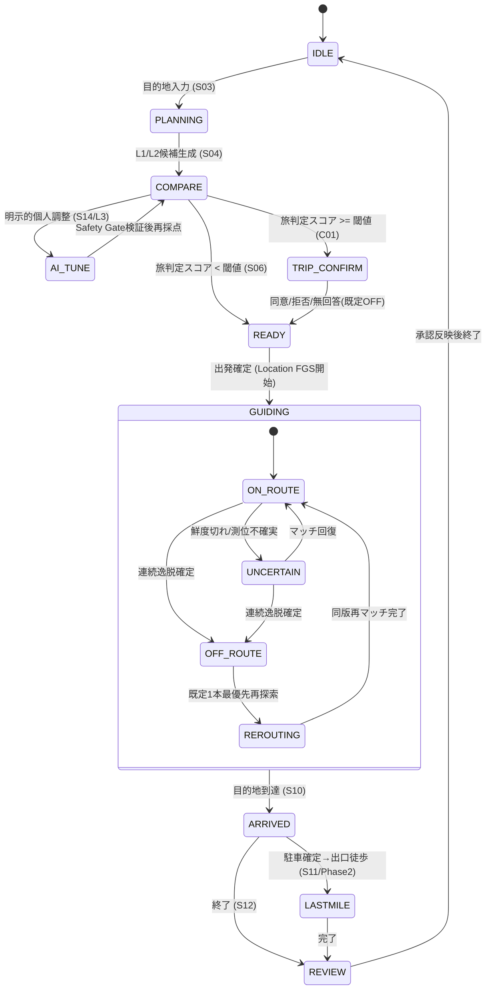

# 01. プロダクト方針と UX 全体仕様

> **対象フェーズ**: Phase 1（β公開）〜 Phase 3
> **関連 ADR**: [ADR-0001](../adr/0001-two-layer-deterministic-routing-first.md), [ADR-0005](../adr/0005-no-hard-lock-and-maneuver-horizon-3.md), [ADR-0006](../adr/0006-gms-optional-and-history-preemption.md)

---

## 1. ビジョンと競合との棲み分け

### 1.1 本質的な課題設定
既存の汎用地図アプリ（Google Maps / Apple Maps）に汎用チャット AI を併設しただけでは、日本の日常運転やドライブにおける以下の断絶が解消されません。

1. **地図状態と意図の断絶**: 画面上の経路・交差点構造・自車の向き・制約条件を共有したまま「+数分で一番怖い右折を避けられる道」を選べない。
2. **空間ハルシネーション**: 汎用 LLM は座標・道路規制・車幅・営業状況を正しく保証できず、運転中の誤誘導リスクが高い。
3. **「速さ偏重」による運転負荷**: 既存ナビの最短・最速ルートは、日本の住宅街の狭路ショートカットや、交通量の多い幹線道路への無信号右折合流を案内しがちである。

### 1.2 勝ち筋と既存ナビとの共存方針
本アプリは **「速く着くナビ」ではなく「道中に安心（運転しやすさ）と意味（旅の発見）が生まれるナビ」** として位置づけます。

- **正面から戦わない領域**: リアルタイム渋滞・事故・工事・オービス情報・車線単位の精密案内・店舗網羅性（個人無料公開では VICS/JARTIC 等のプローブ契約・継続保守が成立しないため）。
- **公式の共存導線**: 静的 ETA と地図データ版を正直に表示し、比較画面や事前確認画面に **「渋滞を考慮したい場合は Google Maps で開く」** という受け渡し導線を公式機能として用意します。

---

## 2. 二面性コンセプト：「日常＝運転しやすさ」×「長距離＝旅モード」

毎日起動される理由を「運転しやすさ」で作り、遠出の楽しさや口コミの理由を「歴史・地名ラジオ」で作ります。

```text
             ┌──────── 出発前 Intent Canvas（共通）────────┐
             │  目的地 → 意図チップ → 2〜3経路の比較 → 決定  │
             └───────────────┬────────────────────────────┘
                             │ 端末内 旅判定スコア
          ┌──────────────────┴──────────────────┐
     日常（スコア閾値未満）                長距離・旅行（スコア閾値以上）
     運転しやすさナビのみ                  出発前に 1 回だけ非モーダル確認
     歴史解説は一切出さない                 同意時のみ「旅モード（歴史解説 ON）」
```

### 2.1 日常の主軸：運転しやすさナビ（普通車メイン）
日本の左側通行環境を前提に、運転者（初心者・久しぶりの運転・高齢者・子ども同乗等）が心理的・物理的負担を感じる要素を意図チップとして可視化・比較します。

| 意図チップ | 意味 | 主な参照属性 |
|---|---|---|
| `右折侵入を避ける` | 信号のない交差点で対向車線を横切って幹線道路へ入る／出る右折を減らす | OSM 交差点トポロジー、道路格・車線数、`highway=traffic_signals` |
| `狭い道を避ける` | 幅員 4.0 m 未満（暫定基準）や 1 車線対面生活道路のショートカットを避ける | `width`、`lanes`、`highway=residential/unclassified` |
| `合流を減らす` | 高速道路の短い合流区間や側道合流の回数を抑える | `highway=motorway_link`、ランプ遷移 |
| `左側で入れる店`（Phase 2〜） | 寄り道検索時に右折進入が必要な反対車線側の施設を除外する | POI 接道方向、中央分離構造（推定） |

#### 比較画面（Intent Canvas）の 3 軸固定原則
比較画面の列は認知負荷を防ぐため **「所要時間差」「対向横断右折（信号なし確認／信号あり保護不明／信号未確認）」「狭路距離（確認／推定／幅未確認生活道路）」の 3 軸に固定** します。

```text
┌ 経路を比べる ──────────────────── [標準] [あなた向け✓] ┐
│ ● 最短          32分  右折7(信号なし3)  狭路1.2km       │
│ ● 運転しやすい  36分  右折2(信号なし0*) 狭路0km  ← おすすめ│
│                                                         │
│ 「+4分で、信号のない右折を3回避けられます（比較候補内）」│
│  *推定・未確認区間を含みます   [地図で違う区間だけ見る]   │
│  ※リアルタイム渋滞は未反映です [Google Maps で渋滞確認] │
│                                                         │
│ [自分の言葉で個人最適化…]  ← 必要時のみ L3 入口          │
└─────────────────────────────────────────────────────────┘
```

- **根拠 3 値の誠実表示**: 確認済み（`confirmed`）／推定（`inferred`）／未確認（`unknown`）を区別し、「比較候補内で改善」と正確に表示します。
- **既定の二層制御**: 日常は 100% 決定論的な L1/L2 で即座に比較し、L3（SLM/BYOK）は自然文による個人調整など明示要求時のみ発火します（詳細は [03-routing-and-two-layer-control.md](03-routing-and-two-layer-control.md)）。

### 2.2 長距離・旅行の上乗せ：旅モード（歴史ラジオ）
- **日常で邪魔しないルール**: 旅判定スコア（[05-inference-tier-and-audio.md](05-inference-tier-and-audio.md) §6）を満たした長距離・旅行計画のときだけ、比較画面下に非モーダルカード（C01）で 1 回だけ確認します。回答がなければ **既定 OFF**、走行中に再度聞きません。
- **解説方針**: 「左手に見える〜」といった視界依存表現を避け、「この先 1 km 付近に〜」「この道はかつて〜」と見えなくても成立する出典付き短文を安全な空白時間のみ読み上げます。

---

## 3. 対象車両と「人（徒歩）」の扱い

### 3.1 対象車両の境界
- **Phase 1 主軸**: **普通乗用車**（日本全国 47 都道府県・車幅等の標準プロファイル）。
- **車種明示・固定原則**: 時速だけでは「渋滞中の車（4 km/h）と徒歩」「電車・同乗者と運転者」を区別できないため、移動手段はユーザーが明示選択し走行セッション内では自動変更しません。
- **対象外の明記**: 大型トラック（高さ・重量規制の OSM 欠損が多く危険なため対象外を明記）。二輪（インカム音声専用モード）・原付（二段階右折）は Phase 2〜3 で個別の交通規制プロファイル整備後に段階追加します。

### 3.2 「人（徒歩）」の扱い（3 者完全合意）
- **Phase 1〜2 の結論**: 独立した都市部徒歩ナビ（階段・段差・横断歩道・地下街階層）は車とデータ粒度も UX も真逆のため初期統合せず、**「駐車後のラストワンマイル徒歩（駐車場の歩行者出口〜目的地／帰路）」** に限定して接続します。
  - Phase 1 からデータ契約上で「駐車場の車両入口」と「歩行者出口」を別 ID として分離保持します（Phase 1 は出口・目的地ピン表示、Phase 2 でラストワンマイル徒歩案内）。
- **Phase 3 の展開**: 車両向けに構築した全国歴史パック資産を再利用し、画面を見られる環境向けの「徒歩散策モード」を別モードとして提供します。

---

## 4. 強制マップ操作ロックなし（ソフト適応 UI）方針

Google Maps が走行中のマップ操作を強制ロックしていない実態および助手席利用者の操作性を踏まえ、**地図のパン・ズーム等の操作は強制ロックしません**。その代わり、道路交通法（携帯電話使用・画面注視禁止）の順守を促すため **「操作したくなる要素を画面から減らす」走行中ソフトモード** へ自動的にレイアウトを切り替えます。

- **速度ヒステリシス**: 走行検知（`>= 8 km/h` が `3 秒` 継続。暫定、値の正本は [07 §1](07-parameters-and-poc-gates.md)）でソフトモードへ入り、停車解除は信号待ちの誤解除を防ぐため `<= 3 km/h` かつ一定時間継続または明示的な停車確認まで維持します。
- **ソフトモードの要点**:
  - 上部約 35〜40% に **マツダ風「3 手先パネル」**（1 つ先大矢印・距離・交差点名＋2/3 つ先コンパクト一覧）を配置し、1.5 秒以内のちら見で判読できる情報量（10 要素以内）に抑制。
  - 地図のパン・ズーム操作は地図領域のみに効かせ、操作終了から **10 秒後** に自動で現在地へ再センタリング。
  - 細かい Intent Canvas 編集や文字入力欄の自動フォーカスを禁止し、折りたたみドロワーへ退避（開いても 15 秒無操作で自動閉）。
  - 初回起動時（S01）に「走行中の操作・注視は道路交通法で禁止されています。操作は停車中または同乗者のみ行い、実際の道路標識を優先してください」と明示同意を取得します。
  - 将来 Android Auto 対応時（Phase 3）は、車載画面側を Google の Car App Library（`NavigationTemplate`）の強制規制へ自動適合させる別 UI とします。

---

## 5. 主要画面一覧と状態遷移

### 5.1 主要画面一覧（Android / Web）

| ID | 画面 / コンポーネント名 | 主な役割 | 導入 Phase |
|---|---|---|---|
| **S01** | 初回起動・安全・ライセンス同意 | 道交法注意、実標識優先、OS 音声可用性・位置権限説明 | Phase 1 |
| **S02** | 日本全国地域パック管理 | 8 地方 / 47 都道府県選択、容量・版表示、R2 ダウンロード・検証・更新 | Phase 1 |
| **S03** | 目的地検索 | 音声ボタン優先、履歴、デジタル庁 ABR 由来町字検索、地図ピン調整 | Phase 1 |
| **S04** | 経路比較（Intent Canvas） | 運転しやすさチップ、3 軸比較表、差分地図ハイライト、確からしさ注記 | Phase 1 |
| **S05** | 経路詳細・全操作リスト | 全マニューバとリスク地点（根拠 3 値）の出発前確認 | Phase 1 |
| **C01** | 旅モード確認カード | 長距離判定時のみ S04 下部に非モーダル表示（流す / 今回はなし / 簡潔） | Phase 1 |
| **S06** | 出発準備（READY） | Intent Contract 3 行要約、必要パック/回廊チェック、機内再計算確認、開始 | Phase 1 |
| **S07** | 案内中・走行（縦 / 横） | マツダ風 3 手先パネル、地図（ロックなし）、回避チップ、下部情報帯 | Phase 1 |
| **S07H** | 案内中・高速道路モード | 有料幹線時の 3 手先ノード＋SA/PA 情報一覧自動切替 | Phase 1 |
| **S08** | 案内中・停車表示 | 停車判定時または確認操作時にドロワー展開を容易化 | Phase 1 |
| **S09** | 走行中ドロワー | 大ボタン中心の簡易操作・全操作リスト（15 秒無操作で自動閉じ） | Phase 1 |
| **S10** | 到着・駐車確定 | 駐車位置記録、ラストワンマイル（Phase 1 は出口ピン、Phase 2 で徒歩案内） | Phase 1〜2 |
| **S11** | ラストワンマイル徒歩 | 駐車地点→目的施設、復路の車位置案内 | Phase 2 |
| **S12** | 走行後レビュー | 「あとで見る」保存歴史カード、意図回避交差点の「覚える？」明示承認 | Phase 1〜2 |
| **S13** | 運転好み・個人プロファイル | L2 苦手交差点・重み・AI プリセットの閲覧 / ON-OFF / 削除 / 全初期化 | Phase 1 |
| **S14** | AI 個人最適化（L3 入力） | 自然文 / 音声による調整 → DSL 差分チッププレビュー → 適用 / 取消 | Phase 1（実験）〜2 |
| **S15** | 設定 | Tier 0/1/2 状態、SLM モデル管理、停車中 BYOK キー設定（Keystore）、単位・左右配置 | Phase 1〜2 |
| **S16** | ドライブ日記 | 軌跡、回避実績、聞いた歴史チャプターの閲覧・`.drivediary` 書き出し | Phase 2 |
| **W01〜W04** | Web 補完版 | 事前計画、プリセット編集、共有受渡（`#` / QR / `.drivediary`）、日記振り返り | Phase 1〜2 |

### 5.2 アプリ・案内・音声 状態遷移図



*(補足: `GUIDING` 中は並行して UI 状態 `{MOVING ⇄ STOPPED}`、道路種別 `{SURFACE ⇄ HIGHWAY}`、および音声スケジューラ状態機械 [05-inference-tier-and-audio.md](05-inference-tier-and-audio.md) が動作します。)*

---

## 6. 公開・コスト・将来有料化方針

- **基本無料公開**: Phase 1 の全コア機能（運転しやすさ比較・全国パック・自前 TBT・ローカル 0.5B SLM 制御・長距離時の基本歴史/地名解説・Web 事前計画）は無料。
- **クラウド費用の遮断**: 運営サーバでユーザーごとの LLM 推論やルート計算を肩代わりしない。高度な旅程作成等が必要なユーザーには停車中 **BYOK（ユーザー自身の API キーを端末 Keystore 等へ保存して直接呼出し）** を提供。
- **公開時の手続き上の注意**: Google Play へ新規個人アカウントで公開する場合、登録料（25 USD）および公開前クローズドテスト要件（テスター人数・期間条件）を満たすスケジュールを初期計画に含めます。また走行中の広告表示は安全・信頼を損なうため入れません。
- **Phase 3 以降の任意有料機能候補（好評時のみ検討）**: 特集・深掘り歴史オーディオパック、複数端末間の暗号化クラウド同期、ドライブ日記のアルバム書き出し機能、バイク専用ワインディング等の専門モード。
